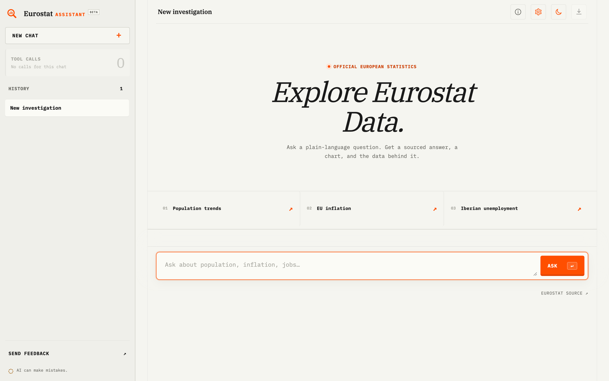

# Eurostat Assistant

Eurostat Assistant is an open-source toolkit for answering natural-language questions with current,
official Eurostat data. It contains two independently usable parts:

- **`fetch-eurostat-data` Codex skill and CLI helper** for dataset discovery, dimension inspection,
  and reproducible data retrieval.
- **Eurostat Assistant reference web app** for conversational investigations with sourced answers,
  interactive charts, filterable tables, and CSV export.

The project is designed for focused questions that can be answered from a bounded slice of one
Eurostat dataset. It is a reference implementation, not a replacement for Eurostat's full Data
Browser or a general-purpose business intelligence platform.



## Current scope

Eurostat Assistant can:

- search Eurostat's table-of-contents metadata for candidate datasets;
- inspect dataset-specific dimensions, category codes, and labels from SDMX structural metadata
  without downloading observations, with a Statistics API compatibility fallback;
- fetch and flatten filtered JSON-stat 2.0 observations;
- preserve the dataset code, title, applied filters, update date, flags, and reproducible API URL;
- return up to 500 observations in a sortable, filterable table with CSV export;
- automatically render clean multi-period trends and explicitly requested line, area,
  grouped/stacked/normalized bar, dot, scatter/bubble,
  heatmap, histogram, and box-plot charts;
- safely modify charts with sorting, top-N filtering, orientation, labels, linear
  trendlines, zero-baseline control, and linear or logarithmic scales;
- click multi-series legend items to highlight one or more series and dim the rest;
- pair two filtered measures by shared geography/period keys for correlation scatter plots;
- stream tool-call status, arguments, duration, and bounded result previews to the app;
- perform bounded candidate discovery before asking about ambiguous measures and limit repeated searches, inspections, and fetches;
- search complete dimension categories for requested labels, including fuzzy accent-insensitive
  region, unit, indicator, and product matching;
- keep device-native investigation history in IndexedDB without a fixed chat-count limit;
- carry recent conversational context and a compact summary into follow-up questions;
- reuse the most recent chart's validated rows for follow-ups without fetching the same API data again.

The current scope does not include:

- arbitrary joins or calculations across multiple datasets;
- maps, dashboards, or model-authored custom visualizations;
- accounts, cloud synchronization, shared investigations, or versioned historical snapshots;
- production controls such as user accounts, rate limiting, caching, monitoring, or usage budgets.

Eurostat publishes the latest version of each dataset through its public APIs. The data endpoints do
not require an API key; the optional web app requires an OpenRouter credential to run its agent.

## Repository layout

- `SKILL.md`: reusable Eurostat agent workflow and answering rules.
- `DEVELOPMENT_HISTORY.md`: chronological change record with commit context and design reasoning.
- `agent_limits.json`: authoritative runtime, query-size, context, and per-tool limits.
- `scripts/eurostat_api.py`: standard-library search, dimensions, and fetch CLI.
- `references/eurostat-api.md`: API patterns and troubleshooting notes.
- `references/chart-selection.md`: chart-purpose matrix and safe modification rules.
- `agents/openai.yaml`: Codex skill display metadata.
- `app/agent_config.py`: shared runtime limits, chart rules, and model tool schemas.
- `app/agent_model.py`: OpenRouter transport and prompt/message construction.
- `app/agent_tools.py`: allow-listed helper execution, validation, and tool-call protocol handling.
- `app/agent_results.py`: structured result, chart, table, provenance, and publication builders.
- `app/sandbox_agent.py`: thin agent orchestration loop executed in a local child process.
- `app/local_agent.py`: local process lifecycle, event streaming, concurrency, and result handling.
- `app/main.py`: FastAPI endpoints and validated public response models.
- `static/`: modular browser UI covering chat transport, development settings, tool traces,
  investigation state, Vega-Lite charts, tables, provenance, and CSV export.
- `tests/`: helper, response-contract, chart, Markdown, and browser-state tests.

## Use the Codex skill

The skill and CLI helper work without OpenRouter or third-party Python packages.

Install this repository as a personal Codex skill:

```bash
mkdir -p ~/.codex/skills
cp -R . ~/.codex/skills/fetch-eurostat-data
```

Restart or reload Codex, then ask it to use `$fetch-eurostat-data`.

You can also call the helper directly:

```bash
python3 scripts/eurostat_api.py search "population by age country"
python3 scripts/eurostat_api.py dimensions demo_pjan
python3 scripts/eurostat_api.py fetch demo_pjan \
  --param geo=DE,FR \
  --param sex=T \
  --param age=TOTAL \
  --last-time-period 5
```

`search` and `dimensions` emit JSON. `fetch` emits CSV by default and also supports
`--output json`. Use `--max-rows` to change the default 500-observation output limit. Fetches must
include `--time` or `--last-time-period` and remain within the configured response-byte and
estimated-cell limits.

## Run the web app

Requirements:

- Python 3.10 or newer;
- [uv](https://docs.astral.sh/uv/);
- an [OpenRouter](https://openrouter.ai/) API key.

Install dependencies and create the local environment file:

```bash
uv sync
cp .env.example .env
```

Add your credentials to `.env`:

```dotenv
OPENROUTER_API_KEY=your_openrouter_api_key
OPENROUTER_MODEL_OPTIONS=provider/default-model,provider/optional-model
OPENROUTER_TITLE_MODEL=openai/gpt-5.4-nano
APP_PASSWORD=choose-a-strong-password
LOCAL_AGENT_CONCURRENCY=2
AIRTABLE_ACCESS_TOKEN=your_airtable_personal_access_token
AIRTABLE_BASE_ID=app_your_base_id
AIRTABLE_TABLE_ID=tbl_your_table_id
```

`OPENROUTER_MODEL_OPTIONS` is the source of truth for the main chat models. It is required,
controls the models shown under **Development → Model**, and uses its first entry as the default. A
browser's selection applies to new questions only and remains local to that browser.
`OPENROUTER_TITLE_MODEL` controls the independent title workflow and defaults to
`openai/gpt-5.4-nano`, a small model suited to fast background work.
`APP_PASSWORD` enables the app lock. When it is set, the browser receives a secure, HTTP-only
session cookie after a successful unlock. Sessions last 12 hours or until **Lock app** is selected,
which revokes the session on the server. Sessions are held in server memory, so restarting the
server or changing `APP_PASSWORD` signs everyone out.
`APP_PASSWORD` is required: the server refuses to start without it. To run without the lock in an
already trusted environment, such as a local machine, set `APP_ALLOW_UNLOCKED=true` instead.
`LOCAL_AGENT_CONCURRENCY` optionally controls the maximum number of agent child processes. It
defaults to `2`; additional requests wait for an available slot.

The three `AIRTABLE_*` variables enable the in-app feedback form. Create a table with these fields:

- `Category`: single select or single-line text;
- `Feedback`: long text;
- `Rating`: number;
- `email`: email or single-line text;
- `Chat log attachment`: attachment;
- `Created at`: created-time field.

Set up Airtable with a Personal Access Token. Legacy API keys no longer work with Airtable's API.

1. Open [Airtable Personal Access Tokens](https://airtable.com/create/tokens) and create a token.
2. Add only the `data.records:write` scope.
3. Under **Access**, add the feedback base as the token's only resource.
4. Copy the base ID and table ID from the table URL. The base ID starts with `app`; the table ID
   starts with `tbl`.
5. Set the token, base ID, and table ID as `AIRTABLE_ACCESS_TOKEN`, `AIRTABLE_BASE_ID`, and
   `AIRTABLE_TABLE_ID`.

The Airtable account that owns the token must have permission to create records and write to every
configured field. Keep the field names and capitalization shown above. Chat logs are sent only when
the user selects the opt-in checkbox. The browser never receives the Airtable token.

Start the app:

```bash
./run.sh
```

Open `http://127.0.0.1:8000`. The server listens on all interfaces by default. Set `HOST` or
`PORT` in the environment to override the defaults.

## Deploy to Railway

The repository includes a production `Dockerfile` and `railway.json`. Railway builds the locked
`uv` environment, starts Uvicorn on the platform-provided `PORT`, and checks `/api/health` before
promoting a deployment.

1. Create a Railway project and deploy this repository from GitHub, or run `railway up` from the
   repository root.
2. Add these service variables in Railway:

   ```dotenv
   OPENROUTER_API_KEY=your_openrouter_api_key
   OPENROUTER_MODEL_OPTIONS=provider/default-model,provider/optional-model
   OPENROUTER_TITLE_MODEL=openai/gpt-5.4-nano
   APP_PASSWORD=choose-a-strong-password
   LOCAL_AGENT_CONCURRENCY=2
   AIRTABLE_ACCESS_TOKEN=your_airtable_personal_access_token
   AIRTABLE_BASE_ID=app_your_base_id
   AIRTABLE_TABLE_ID=tbl_your_table_id
   ```

3. Generate a public domain from the service's **Settings → Networking** page.

Do not set `PORT`; Railway injects it automatically.
Do not set `APP_ALLOW_UNLOCKED` on a public deployment. The health endpoint is intentionally
public so Railway can verify a locked deployment, but it exposes only service readiness booleans.

## How the app works

1. The browser sends a question, up to six recent messages, an extractive summary of older
   messages, and the most recent structured chart result to `POST /api/chat/stream`.
2. FastAPI starts a short-lived local child process with a minimal environment, a per-request
   temporary catalogue cache, and a 180-second timeout.
3. The model can use four allow-listed tools: dataset search, metadata-first dimension inspection, bounded fetch,
   and validated publication of a selected, re-charted, or paired result.
4. The backend streams each actual tool invocation to the browser as newline-delimited JSON.
5. The host assigns each successful fetch a result ID, publishes a single fetch automatically or
   an explicitly selected fetch after multiple attempts, validates chart fields, and derives a
   conservative trend chart when appropriate.
6. FastAPI validates the public result before the browser renders it. The browser does not execute
   model-authored HTML or JavaScript.

The browser translates the validated `chart` contract into a bounded Vega-Lite specification and
renders it as SVG with Vega-Embed. Vega 6.2.0, Vega-Lite 6.4.3, and Vega-Embed 7.1.0 are loaded from
the jsDelivr CDN; the model never supplies arbitrary Vega-Lite specifications.

Complete display history stays on the device in the browser's IndexedDB storage. Investigation
metadata, messages, and diagnostic events are stored separately, so the app loads the lightweight
history list plus the active investigation instead of rewriting or loading every saved response.
When the first question is sent, the browser starts a separate title request in parallel with the
main agent. The title workflow uses `OPENROUTER_TITLE_MODEL` and updates the history list as soon as
it completes. If it is unavailable, the browser keeps a shortened first-prompt fallback.
Existing `eurostat-lens-chats-v1` local-storage history is migrated automatically on first launch.
History remains specific to the current browser profile and site origin; clearing site data removes
it, and the browser's normal storage quota still applies. The agent receives the six most recent
messages, a summary of at most 2,400 characters, and (when available) the latest chart's validated
result.
The structured result is treated as reusable Eurostat tool output, so follow-ups that are answerable
from those rows do not repeat dataset search, dimension inspection, or the data fetch. Reusable
context is not automatically republished: text-only and unavailable-data answers return no new
result, while explicit table/chart reuse selects the previous result. A different dataset, filter,
geography, time range, or unavailable fact still triggers a new lookup.

The agent executes at most 12 unique tools per request, with smaller per-tool ceilings. Identical
calls reuse their earlier output, invalid complete-dimension filters and over-broad cell estimates
are rejected before the observation request, Eurostat response bytes are capped, and zero-row
fetches do not become public results. Runtime limits have one source of truth in
`agent_limits.json`.

The local agent process is not an operating-system sandbox. It runs as the container's unprivileged
application user, receives only an allow-listed subset of environment variables, and is terminated
with its helper processes when the request times out. Do not add arbitrary shell or user-authored
code execution without introducing a stronger isolation boundary.

Use **Download log** in the current investigation header to export a local JSON diagnostic log.
The export contains the chat, model used for each response, dataset and filter metadata,
tool-call status, timing for new responses, compacted context, and recorded request errors.
Observation rows and tool result previews are excluded. Review the file before sharing because
the chat text may still contain reported values.

Use **Development** in the sidebar (or open `/settings/development`) to select an enabled model and
inspect the request lifecycle, tool descriptions and limits, runtime services, privacy behavior,
and app version.

### HTTP endpoints

- `GET /`: web interface.
- `GET /settings/development`: development settings interface.
- `GET /api/auth/status`: app-lock status.
- `POST /api/auth/unlock`: unlock the app with `APP_PASSWORD`.
- `POST /api/auth/lock`: revoke the current app session and clear its cookie.
- `POST /api/feedback`: validate feedback, create an Airtable record, and optionally attach the
  current downloadable chat log.
- `GET /api/health`: public service and agent-credential readiness probe.
- `GET /api/settings/development`: enabled models, tools, limits, and runtime metadata.
- `POST /api/chat`: validated, non-streaming chat response.
- `POST /api/chat/stream`: newline-delimited status, tool-call, result, and error events.

A successful chat result follows this public contract:

```json
{
  "answer": "The population increased...",
  "confidence": "high",
  "model": "openai/gpt-5.6-luna-pro",
  "result": {
    "dataset": {
      "code": "demo_pjan",
      "title": "Population on 1 January by age and sex",
      "updated": "2026-07-09T11:00:00+0200",
      "source_url": "https://ec.europa.eu/eurostat/api/..."
    },
    "sources": [],
    "filters": {
      "geo": ["DE", "FR"],
      "sex": ["T"],
      "age": ["TOTAL"],
      "lastTimePeriod": ["5"]
    },
    "columns": [],
    "rows": [],
    "chart": {
      "type": "line",
      "purpose": "trend",
      "orientation": null,
      "x": "time_label",
      "y": "value",
      "series": "geo_label",
      "title": "Population on 1 January by age and sex",
      "stack": "none",
      "sort": "natural",
      "trendline": "none",
      "labels": "hover",
      "scale": "linear",
      "zero_baseline": "auto"
    },
    "warnings": []
  },
  "tool_calls": 4,
  "tool_call_details": []
}
```

Dataset codes shown in answers and source cards link to the corresponding Eurostat Data Browser
page. The API-query action opens the exact filtered request and returned rows in an in-app panel.
The response log shows a brief purpose for each agent action; raw arguments and result previews
remain available under collapsed technical details.

When the agent needs clarification, it can search and inspect candidate datasets without fetching
observations. Its grounded question is returned in `answer`, while `result` remains `null`. A failed
lookup can also return a conversational `answer` with no result.

For correlation questions spanning two datasets, the agent joins observations on shared keys such
as geography and period. The result uses `chart.type: "scatter"`, includes both numeric measures in
each table row, and lists both Eurostat datasets in `sources`.

For chart-only follow-ups, the agent reuses the latest validated rows and calls `publish_result`
with `context` and a validated chart intent.
The host resolves `type: "auto"` from the requested analytical purpose, validates field roles and
cardinality, and emits only the bounded public chart contract. The model never supplies raw
Vega-Lite, HTML, or JavaScript.

## Tests

```bash
uv sync --frozen
npm ci
npx playwright install chromium
uv run python -m unittest discover -v
node --check static/app.js
node --check static/chat_store.js
node --check static/chart.js
npm run test:unit
npm run test:smoke
uv run python -m tests.prompt_regression replay
```

The Playwright smoke test starts the assembled FastAPI app with isolated test configuration, loads
it in headless Chrome, and fails on browser console or runtime errors. The remaining automated
suite uses recorded JSON-stat-shaped fixtures. None of these tests require real API keys. A small,
filtered live request is useful as a separate canary because Eurostat always exposes the latest
dataset version.

### Prompt regression scenarios

Prompt regressions are stored as paired files:

- `tests/prompt_scenarios/<id>.json` contains prompts, tags, and semantic expectations.
- `tests/prompt_cassettes/<id>.json` contains recorded model responses and Eurostat tool outputs.

Add a scenario by copying this minimal shape:

```json
{
  "schema_version": 1,
  "id": "population_trend",
  "tags": ["population", "smoke"],
  "turns": [
    {
      "prompt": "Compare population in Germany and France since 2020",
      "expect": {
        "result": "present",
        "dataset": "demo_pjan",
        "filters": {"geo": ["DE", "FR"]},
        "row_count": {"min": 2},
        "chart": {"type": "line", "series": "geo_label"},
        "no_tool_errors": true,
        "provenance": true
      }
    }
  ]
}
```

Record it once with live services, inspect the generated cassette, then replay it offline:

```bash
uv run python -m tests.prompt_regression record population_trend
uv run python -m tests.prompt_regression replay population_trend
```

Use `record <id> --update` to intentionally refresh an existing cassette. Run live semantic checks
without changing cassettes with:

```bash
uv run python -m tests.prompt_regression live --tag smoke
```

Supported expectations include result presence, dataset codes, forbidden datasets, exact filters,
row counts or ranges, required row subsets, row-key uniqueness, numeric non-zero/min/max checks,
chart fields, exact tool order, tool-error rejection, answer contains/excludes/regex checks,
warning text, and provenance. Raw tool markup and duplicate tool calls are rejected by default.
Replay failures identify the turn, first failed assertion, and a one-scenario rerun command.

Recording strips reasoning fields and does not capture credentials or HTTP headers. Cassettes contain
public Eurostat observations and generated answer text, so review changes before committing them.

## License

This project is available under the [MIT License](LICENSE).
